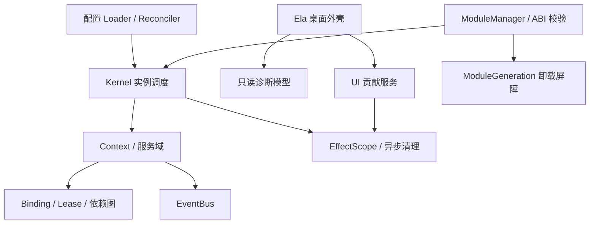

# Cordis 启发的 C++17 / Qt 5.15.2 / ElaWidget 插件平台开发指南

交付日期：2026-10-23。版本：研究与设计基线 1.0。本文可直接编辑；所有 C++ API 均为待实现草案，不代表已有产品或编译通过的 SDK。

## 1. 目标、证据等级与阅读顺序

目标是保留 Cordis 的上下文、可撤销副作用、响应式依赖和实例生命周期语义，形成原生桌面插件内核。DSH 是工程参考。Qt 提供事件循环、对象模型和动态库能力，ElaWidgetTools 提供外壳界面，不参与内核依赖解析。

严格按以下顺序研究：论文 → 上游 Cordis 实现和测试 → DSH vendored Cordis / Loader / HMR → C++17 与 Qt / Ela 映射。本文按同样顺序组织。

证据标签：

- **[核实]**：本次直接阅读的论文、固定提交源码或测试文本；阅读测试不等于运行测试。
- **[设计]**：本项目作出的契约选择；即使受到 Cordis 启发，也不冒充上游行为。
- **[待验]**：需要编译、运行、故障注入或进一步源码核实的事项。

前序聊天可取回的正文主要是用户目标，助手内容返回引用占位符，因此本文不假定已继承不可见的详细方案。`sources/` 为空，未修改任何同步资料。研究副本放在 `research/`，均在该目录之外交付文档。

### 1.1 固定版本

| 来源 | 本次基线 | 用途 |
|---|---|---|
| 论文 | arXiv:2608.25512v1，2026-08-26，92 页 | 概念、模型边界与实现章节 |
| Cordis 上游 | `35fdc969e4b6c48c48ed44717c7a018324e4dd88` | 当前源码与测试文本 |
| DSH | `687f282e8625c6b8d11ff58211a90524be2e4317` | vendored 运行时代码与差异日志 |
| Qt qtbase | `40143c189b7c1bf3c2058b77d00ea5c4e3be8b28`，tag `v5.15.2` | 精确版本的装载与对象销毁语义 |
| ElaWidgetTools | `aae58f5d0d98e05eabe10c263aa7da5f2491d702` | 构建约束和导航 API |

主证据的固定链接、符号和本地位置见配套 [研究证据索引](research-evidence.md)。引用编号在全文保持稳定。

## 2. 第一阶段：论文研究

### 2.1 可迁移的核心结论

**[核实，P1]** 论文区分时间可组合性和空间可组合性：前者围绕移除组件时撤回影响，后者围绕环境变化时协调依赖。§3 提出可撤销 effect、响应式 coeffect 和统一 context；§4 建模 component / fiber；§5 给出运行时与 Loader 实现；§6 讨论系统边界等限制。

**[设计]** 将论文概念变成四条工程约束：资源创建伴随清理登记；依赖读取经过 Context；实例拥有自己的 effect 集合；依赖实现变化驱动实例停止和重新激活。本文不重述数学证明，也不声称原生实现已经满足论文定理。

### 2.2 研究到设计的接口

| 研究问题 | 工程要求 | 验收观察量 |
|---|---|---|
| 影响如何撤回 | Context 资源适配器返回清理令牌 | 卸载后监听器、定时器、UI 注册归零 |
| 依赖如何变化 | 绑定记录含实现身份和代次 | 提供者替换后消费者不再使用旧绑定 |
| 实例如何组合 | Runtime 和 Fiber 分开 | 同一个插件可多实例、独立配置和清理 |
| 保证覆盖哪里 | 显式定义资源边界 | 外部持久化和未托管线程单独报告 |

**[设计]** “撤回副作用”仅对经过托管接口的资源作承诺。文件写入、数据库提交、网络请求产生的外部结果，必须另行设计事务或补偿；不能以调用了一个 disposer 就宣称恢复历史世界状态。第三方原生代码绕过接口所做的行为不在内核可验证范围内。

## 3. 第二阶段：上游源码与测试

### 3.1 Context、Registry、Runtime、Fiber

**[核实，U1/U2]** Registry 以规范化后的插件回调建立 Runtime；Runtime 记录多个 Fiber。`plugin()` 构造 Fiber，并返回带等待能力的包装对象。Fiber 具有自己的 Context、原始配置、依赖声明、已提交绑定、provisions、effects 和 inertia。不要把 registry 中的插件类型数量当成活跃实例数量。

**[核实，U1]** 源码状态为 `PENDING / LOADING / ACTIVE / FAILED / DISPOSED / UNLOADING`。`_refresh()` 根据 revision 和注入实现 uid 构造 epoch，缺失依赖时目标变为 inactive。`_reload()` 在执行前固定 committed 依赖；`_unload()` 等待消费者清理后再释放自身资源；`update()` 清除错误并允许更新钩子决定是否重启。失败实例不会因为任意一次依赖通知自动恢复。

**[设计]** C++ 中的 Fiber 是逻辑实例，绝不使用 OS fiber 或 QThread 代表它。Runtime 代表插件定义或模块代次；一个 Runtime 可产生多个 Instance。

### 3.2 Effect 的真实清理规则

**[核实，U1/U3]** effect 支持同步清理函数、Promise、同步或异步迭代器。组合 effect 内部收集的清理按逆序执行；`dispose.spec.ts` 验证手动和实例清理的单次执行以及组合顺序。Fiber 顶层卸载则通过 `Promise.all` 启动独立 disposer，不应概括成“所有资源全局严格 LIFO”。

**[设计]** C++ 初版采用每个 effect group 逆序清理，依赖约束优先于独立 group 的执行顺序；首版可串行处理独立 group，后续并行化须保持消费者先完成的约束。与上游调度时序存在差异，不能声明完全行为等价。

### 3.3 服务与依赖

**[核实，U4]** Reflect 服务记录 isolate key、实现 uid、owner 和 dependents；同一隔离域的同名提供者冲突。严格查找仅返回 ACTIVE 提供者。`provide()` 本身是 effect，撤销时先撤回可发现绑定，通知消费者，再等待旧绑定的 dependents 释放。

**[核实，U5]** `service-dispose.spec.ts` 明确覆盖消费者异步清理时资源仍然可用、传递依赖、清理抛错、隔离域以及启动中回滚等场景。这比“删除服务 map 中的一项”要求更强。

**[设计]** 新请求不能获取已撤回的绑定；已提交的消费者在 teardown 中持有旧绑定的清理租约。可发现性与资源实际存活时间分开管理。

**[核实，U6]** isolate 测试覆盖服务和事件隔离、同名服务视图。**[待验]** intercept、shadow、traceable receiver 的完整组合语义尚未逐个移植验证，首版只实现显式域和注入，不承诺 JS Proxy 同等能力。

### 3.4 Event 不是普通 signal 的别名

**[核实，U7/U8]** 事件有 `emit / parallel / serial / bail / waterfall`；注册由 effect 托管。bail 判定是值不为 null、false、undefined，因此 JS 的 0 和空字符串也会终止。serial 按顺序 await 并使用同样的终止判定；parallel 等全部结果并聚合错误。waterfall 使用 `next()` 包装下游，重复调用 next 会抛错，而不是简单地传递前一个返回值。

**[设计]** C++ 用显式 `Continue / Stop(value)` 表示终止，避免把 QVariant 布尔转换当成 JS 判定。用 `Next` 的单次令牌实现同步 waterfall；跨线程异步 middleware 另开 API，禁止同步 API 暗中阻塞 GUI。

### 3.5 Loader 测试提供的设计输入

**[核实，U9]** `loader/tests/rebuild.spec.ts` 覆盖条目改名、导入期间改变目标、重建后的状态和持久化 disabled 等问题。**[待验]** 本次没有运行该仓库测试，也没有逐项执行全部 core、Loader、HMR 用例；后文测试矩阵是待实施计划。

## 4. 第三阶段：DSH vendored Cordis / Loader / HMR

### 4.1 版本关系和差异归属

**[核实，D1]** `vendor/README.md` 标明 core 为 Cordis `4.0.0-rc.7`、Loader 为 `1.0.0-rc.5`，其来源提交为 `56b3d4f725681cf4556c1a8695a709cc3b6eed74`；HMR 等包记录 fork 来源 `abb0a307cb1d3b0947f455d590cf5ba922d4caa4`。这些是 vendor 清单记载，不是本次上游 HEAD。包使用 `@deepseek-ai` scope，并有本地修改。

**[待验]** fork 的历史和清单来源提交没有全部检出比较；不能把日志的每个条目当作已逐行独立验证。本次重点直接核对下列运行时路径。

### 4.2 Cordis：重入与清理屏障

**[核实，D2]** vendored `Fiber.effect()` 在运行 setup 前将 wrapper 放入 owner 清理列表；同步 setup 中触发卸载时可以等待 setup barrier。异步 cleanup 在完成前保持 owner 可见；内部组合清理可以加入已经在运行的清理任务。UNLOADING 状态拒绝新 effect，避免清理快照之后漏出新资源。

**[设计]** C++ 必须先登记 effect 控制块，再运行插件 setup。控制块至少有 `SettingUp / Live / Closing / Closed / Failed` 和 setup、cleanup 两个完成屏障。析构函数只能做无阻塞兜底，不能承担需要事件循环参与的完整卸载。

### 4.3 Loader：身份、配置与非事务性

**[核实，D3]** Entry 保留 id、options、fiber、parent、subtree 和原始 moduleNamespace；`update()` 先改 options 再驱动状态。配置仅 volatile 字段改变时可更新运行中的 reference；普通有效值变化退回普通生命周期。解析失败时运行中的 references 保持原值。

**[核实，D1/D3]** vendor 日志明确说明 Loader 采用 eager、非事务式变更；配置文件语法保护不能保证插件激活失败后整个树恢复原状。不要将 YAML 解析成功、配置写盘成功和所有插件启动成功合并成一个布尔状态。

**[设计]** 本平台至少区分 desired config、validated config、running generation 和 persisted revision。初版不执行 `!!js`，只提供数据配置与显式服务引用；volatile 能力推迟到普通重启语义稳定之后。

### 4.4 HMR：缓存、替换、恢复的范围

**[核实，D4]** `partialReload()` 根据模块依赖筛选 reload 集合；备份并清理 ESM 和 CJS 缓存，先尝试导入新模块；导入失败恢复缓存。之后删除旧插件注册并创建新实例；同步替换失败路径尝试重新注册旧插件。构造过程要求 Node 内部 loader 支持。

**[设计推论，依据 D4]** 该路径中的缓存恢复和旧插件重注册，不等于异步激活、外部副作用或旧内存状态的原子回滚。Node 模块缓存与原生 DLL 的代码驻留条件不同，因此不能把这一机制直接翻译为 QLibrary::unload。

### 4.5 移植取舍

| 能力 | C++ 首版 | 后续 |
|---|---|---|
| effect owner、依赖变化、实例清理 | 必须实现 | 维护语义回归 |
| 多实例、域隔离、显式注入 | 必须实现 | 完善拦截与追踪 |
| Loader 稳定 id 和配置 reconcile | 必须实现 | 增加差异预览 |
| JS 表达式、Proxy、异步生成器 | 改为显式接口 | 如有需求再设计 |
| volatile config | 普通重启 | schema 稳定后增加 |
| DLL 原地热卸载 | 默认关闭 | 满足卸载屏障再开放 |
| 模块级 HMR | 保留旧代并受控切换 | 可选物理卸载或进程隔离 |

## 5. 第四阶段：C++17 / Qt 5.15.2 / Ela 架构

以下所有章节默认为 **[设计]**，带 [核实] 的 Qt / Ela 条目除外。



### 5.1 模块边界

| 模块 | 职责 | 不变量 |
|---|---|---|
| core | Context、Instance、Effect、Binding、Event | 无 Ela 依赖；资源归属可追踪 |
| qt-adapter | scheduler、timer、connection、QObject 资源 | 尊重对象线程亲和性 |
| loader | schema、manifest、差异、持久化 | id 与运行时实例身份分开 |
| module-host | 加载器、代次、ABI、卸载门禁 | 代码仍可能执行时保留库句柄 |
| ui-contract | 页面、命令、菜单贡献接口 | 每个贡献必须可撤销 |
| ela-shell | ElaWindow、管理页、状态展示 | 只通过服务调用业务 |
| plugin-sdk | 源码 SDK、C ABI 头、示例 | 公共契约与内核实现分离 |

建议目录：`src/core`、`src/qt`、`src/loader`、`src/module`、`src/ui`、`app`、`sdk/include`、`examples`、`tests`。研究副本不加入产品构建或安装。

### 5.2 身份必须分层

- `PluginId`：逻辑类型，如 `org.example.notes`。
- `EntryId`：配置树中的稳定路径，不能用数组下标。
- `InstanceId`：每次实例化唯一；重新激活可保留实例 id 但增加 activation epoch。
- `ModuleGeneration`：某次 DLL 加载或构建产物的身份。
- `BindingId`：具体服务实现身份；同名新服务必须使用新 id。
- `RealmId`：服务解析隔离域。

禁止用 QObject 地址、DLL 文件路径、显示名称充当唯一版本身份。

## 6. 内核 API 草案

以下为接口形状，不是可直接编译的完整头文件。`Task<T>` 是本项目待实现的事件循环完成对象，不是 C++20 coroutine、Qt 6 QPromise 或 Qt 5 的现成 continuation API。

```cpp
using Epoch = std::uint64_t;
struct Completion;                 // 成功 / 错误列表 / 超时状态
template<class T> class Task;       // thenOn(scheduler, callback)，禁止 GUI wait()
class EffectToken;                 // 显式 close()；析构不等待
class CleanupLease;
template<class T> class ServiceRef; // 受控访问，不暴露可长期保存的裸指针

enum class InstanceState {
    Pending, Loading, Active, Unloading, Failed, Disposed
};
struct PluginSpec {
    PluginId id;
    std::vector<DependencySpec> inject;
    std::vector<ServiceSpec> provide;
    ConfigSchema schema;
    std::function<Task<void>(Context&, const ConfigSnapshot&)> activate;
};
class Context {
public:
    Task<InstanceHandle> plugin(const PluginSpec&, ConfigSnapshot);
    Task<InstanceHandle> inject(DependencySet, Activation);
    EffectToken effect(EffectSetup, std::string label);
    template<class T> EffectToken provide(ServiceKey<T>, OwnedService<T>);
    template<class T> ServiceRef<T> require(ServiceKey<T>);
    Context isolate(ServiceName, RealmId) const;
    EffectToken on(EventKey, EventListener, EventOptions = {});
};
class InstanceHandle {
public:
    Task<Completion> stop();
    Task<Completion> update(ConfigSnapshot);
    Task<Completion> settled();
    InstanceSnapshot snapshot() const;
};
```

`require()` 检查声明、realm、ABI 和 committed binding；越界读返回结构化错误。运行时只允许 owner 写入自己的提供项。服务可能跨模块时，OwnedService 的销毁函数和模块句柄必须绑定，不能在库已释放后运行 deleter。

`EffectToken` 是可复制的控制句柄或显式 move-only 句柄，两种方案需在 P1 冻结；无论选择哪种，owner 保留独立控制块。不能因为插件把临时 token 丢掉就自动注销刚创建的服务。另提供 `ScopedEffect` 表达词法 RAII 的提前撤销。重复 close 加入同一个完成结果，这是本平台契约，区别于 DSH 对重复公开 disposer 返回值的兼容处理。

### 6.1 插件编写流程

1. 声明插件 id、配置 schema、所需和所供服务。
2. activate 只经 Context 注册资源；每个外部对象都有清理和线程归属。
3. 持有受控服务引用，异步任务记录 instance epoch。
4. setup 中每获得一个资源立即登记对应 cleanup；不得等 setup 最后才一次登记。
5. cleanup 使用已有 CleanupLease，不创建新 effect；等待自己启动的任务结束。

例如笔记插件声明依赖 `ui.pages/v1`、`storage/v1`，由 UI 服务创建页面并返回贡献 token；存储连接由 storage 提供者拥有，笔记插件清理完成后才释放其存储租约。不要把窗口指针和数据库全局单例直接塞进插件。

## 7. 生命周期与依赖算法

### 7.1 状态与目标分开

状态描述当前动作，target 描述下一稳定目标。更新、卸载和依赖通知只修改 target epoch，由单一调度器收敛；禁止同时执行两次 activate。

| 当前状态 | 触发 | 动作 / 下一状态 |
|---|---|---|
| Pending | 依赖完整、未 disabled | 固定 bindings，进入 Loading |
| Loading | setup 完成且 epoch 未变 | 发布自身服务可用性，进入 Active |
| Loading | 目标变化 / stop | 等 setup checkpoint，清理所得资源 |
| Active | 依赖消失 / 身份改变 / 配置重启 | 撤回发现入口，进入 Unloading |
| Unloading | 所有清理完成 | Pending、Loading 或 Disposed，按 target 决定 |
| Loading | setup 失败 | 回滚已有资源，稳定为 Failed |
| Failed | 显式 retry / update | 新 epoch，再次计算依赖 |

超时不等于清理成功。超时是诊断结果；若仍有运行任务，模块保持驻留，管理界面显示“已停用，等待清理/需重启”。

### 7.2 依赖解析

服务键建议 `(name, interfaceMajor, realm)`，同一键只接受一个活动实现；minor 通过 capability 协商。注册采用确定性冲突错误，不使用“最后加载覆盖”。未满足强依赖则 Pending；可选能力用子 `inject()` 实例表达，避免悄悄扩大父实例的重启范围。

建立声明依赖图和实际绑定图。每次服务变化通过 `serviceKey -> interested instances` 反向索引增量重算，epoch 包含 revision 和排序后的 binding ids。同名同地址的新代次仍视为变化。

循环依赖检测输出完整路径；无根的强依赖环不能自启动。首版拒绝确定的强依赖环；动态未知提供者保持 Pending 并诊断。不要尝试通过 QObject 延迟指针打破语义上的循环；可抽取公共服务或把合作部分合并为一个组件。

### 7.3 停止提供者的顺序

1. 标记旧 binding 为 retiring，禁止新消费者进入。
2. 对实际消费者发出失效，取消新的业务工作。
3. 消费者在旧 committed binding 上完成 teardown；传递消费者也必须完成。
4. 释放消费者租约，再清理提供者资源。
5. 清理完成后销毁实例；最后才评估模块卸载。

必须同时考虑父子所有权边和依赖边，避免父实例先释放子实例需要的资源。停止根实例也走同一条路径，不使用另一个简化分支。

## 8. Effect、Event 与可观测性

Effect 控制块记录 owner、label、创建位置、epoch、清理状态、错误、线程归属和 ModuleLease。setup 执行前先注册；收集的 cleanup 按组内逆序执行。某项清理失败后仍尝试剩余项，最后返回错误集合。资源异常遗留时保持模块驻留。

Qt adapter 至少实现：timer 停止并销毁；connection 断开并使排队回调失效；watcher 停止监听；任务取消并 join；QObject 在其线程销毁并确认 destroyed；页面撤销导航和对象；临时文件/句柄关闭。网络外部结果另行补偿，不纳入自动回滚承诺。

| Event API | 本项目契约 |
|---|---|
| emit | 内核线程同步调用，失败传播，按快照顺序 |
| parallel | 逻辑并发，等待全部，聚合错误；不隐含多线程 |
| serial | 顺序异步调用，遇显式 Stop 停止 |
| bail | 同步调用至 Stop，不接受异步 listener |
| waterfall | 同步 middleware，next 至多一次，可不调用以 veto |
| post | Qt 扩展：跨线程传递宿主定义的数据，epoch 过期丢弃 |

事件快照中的注册项即使已取消，也必须在调用前重新检查 liveness。once 在进入 callback 前注销，防止重入双调用。scope filter 与 global 权限明确分开。内核状态通知逐个隔离观察者错误，不能让 UI 日志异常打断清理。

诊断输出包括 instance id、entry id、state、target epoch、缺失依赖、绑定代次、effect 树、未完成任务和模块驻留理由。日志给出触发原因及旧/新状态；敏感配置字段脱敏。状态快照只能在调度线程构建，UI 读取不可变副本。

## 9. 配置与 Loader

### 9.1 声明格式草案

```yaml
formatVersion: 1
plugins:
  - id: storage-main
    plugin: org.example.storage
    module: storage
    disabled: false
    config:
      path: data/notes.db
  - id: notes-main
    plugin: org.example.notes
    module: notes
    inject: [storage/v1, ui.pages/v1]
    config:
      title: 我的笔记
```

这是本项目格式，不是可直接交给 Cordis 的配置。module 通过 manifest 解析受控绝对路径，配置只引用逻辑名。对重复 id、未知字段、服务版本、环、路径越界和 schema 错误给出条目位置。路径相对配置文件解析，持久化时保留原始形式。

### 9.2 Reconcile 和更新

流程为读取候选 → 完整解析/schema 校验 → 构造差异计划 → UI 可预览 → 串行执行 → 记录每条结果 → 持久化 revision。候选语法错误不修改运行树。稳定 id 匹配实例；改 plugin/module/realm/inject 默认重建；纯 config 默认重启；无变化不执行。

热更新字段必须由 schema 显式标记，并通过 `prepareUpdate()` 产生无外部副作用的候选；commit 不得失败，否则走停用重建。不要仅凭 JSON diff 判断一个字段可热更新。Raw、默认值合并后的 effective 和运行时 snapshot 都保留，防止服务替换后复用陈旧求值。

初版保证单条更新的结果可追踪，整树不承诺原子性。若中途失败，记录已生效条目，按策略停止计划或尝试重新应用旧配置；恢复可能重新激活旧插件，不能恢复任意内存状态。需要强原子性的业务使用进程或业务事务。

配置写入由单队列负责，采用同目录临时文件及提交替换，记录持久化失败并支持有界重试。watcher 合并重复通知、处理 rename 后重新监听，以 revision/hash 区分自身写入。运行成功而写盘失败要明确显示，不能伪报保存完成。

## 10. 原生插件 ABI 与卸载安全

### 10.1 两种装载路径

同一工具链的桌面 UI 插件可选 QPluginLoader + Q_DECLARE_INTERFACE，锁定 Qt 5.15.2、编译器、架构、CRT 和 Debug/Release。该 C++ 接口不是跨编译器 ABI。

普通服务插件建议 QLibrary + 单个 C 入口，以不透明句柄和函数表传递数据；不得跨边界传 STL、QString、异常、RTTI 或由另一侧 delete 的对象。C ABI 本身也必须锁定调用约定、架构、对齐和支持的平台，不能宣称任意二进制兼容。服务与 UI 装载路径共享 ModuleManager，每个模块只选一个装载机制。

```c
/* ABI 形状草案，需补齐所有类型、错误码和所有权说明后才能发布 */
typedef struct CordisHostV1 CordisHostV1;
typedef struct CordisPluginV1 CordisPluginV1;
/* Windows 明确导出 extern "C" 和 __cdecl；C 编译时无 extern "C" */
int32_t cordis_query_v1(uint32_t host_abi,
                       const CordisHostV1* host,
                       CordisPluginV1* out_plugin);
/* 每张表首字段为 struct_size / abi_major / abi_minor。 */
```

函数表包含 create、start_async、request_stop、destroy；host 包含 log、alloc/free 或 buffer-release、dispatch、服务注册。异步 completion 使用 request id，exactly-once 完成；请求取消与结果到达可竞态，宿主控制块负责仲裁。query 阶段不得注册业务资源；所有 C++ 异常在边界捕获并转换错误码。

字符串使用 UTF-8 字节加长度，结构版本允许尾部扩展，读取前校验 size；宿主提供或拥有输出 buffer，插件创建的对象由插件 destroy。函数指针、deleter、opaque handle 和 callback 都计入模块存活账目。跨 ABI 的错误文本复制到宿主内存。

### 10.2 物理卸载条件

**[核实，Q1]** Qt 5.15.2 的 QPluginLoader 默认设置 `PreventUnloadHint`；其卸载还涉及同一库的多个 loader 引用。返回成功不能替代本平台的资源证明。

本平台默认允许逻辑停用但保持 DLL 驻留。只有以下条件全部满足才能尝试释放库：

1. 所有实例已停止，消费者及 cleanup lease 全部释放。
2. setup、cleanup、调用中的函数、后台线程和异步 completion 计数均为零。
3. 服务对象、QObject、页面、定时器及第三方资源已销毁并确认。
4. 事件、回调、std::function 捕获和自定义 deleter 已在 DLL 驻留时销毁。
5. 队列中不存在会执行 DLL 代码或使用 DLL 析构函数的数据。
6. 无 QMetaType 自定义类型、静态注册器、TLS 或外部组件继续引用该模块代码；无法证明则禁止卸载。

`QPointer` 只能观察 QObject 是否存活，不能证明代码已无人使用。`shared_ptr` 仅保护对象，若其 deleter 在 DLL 内仍需 ModuleLease。queued disconnect 不能视作队列排空。即使 epoch 使回调不执行，销毁捕获本身也可能运行 DLL 代码，因此必须保留模块直到队列载荷销毁。

**[核实，Q2]** QObject 的延迟销毁依赖事件循环时机。**[设计]** 不用一次 `processEvents()` 当作全局卸载屏障；由资源适配器确认销毁和任务完成。超时、未知资源、unload 失败时保留句柄并要求重启。

### 10.3 原生热替换协议

产物以内容 hash/版本目录存放，避免覆盖 Windows 中正在加载的 DLL。预检 manifest 和 ABI；载入新代只做无副作用 query；暂停受影响消费者；清理旧代实例；激活新代并等待 settled；成功后恢复消费者。可选持久状态必须以版本化数据迁移，不传旧对象指针。

失败时保留旧 DLL，重新激活旧配置；恢复失败报告停用状态。新代激活完成之前不向新业务发布服务。存在停机窗口，初版不承诺无缝切换。若旧代不能清理，不继续物理卸载；可请求重启或改用独立进程插件。进程隔离路径另用消息协议，不传 QWidget。

## 11. 线程模型与 Qt / Ela 集成

**[核实，Q3]** Qt GUI 对象只能用于主线程，timer/socket 等事件驱动对象也有线程亲和约束。**[设计]** 初版内核调度器放在 GUI 主线程，所有 registry、binding、状态机写操作串行化；禁止插件 activate/cleanup 长时间阻塞。CPU/IO 工作进入 worker，结果以宿主数据对象和 epoch 返回。

C++17 的取消使用项目自有 CancellationSource，不使用 `std::stop_token`。Task completion 通过 queued invocation 回主线程；GUI 线程不调用 future.get、线程 join 或 BlockingQueuedConnection 等待 worker；worker 不持锁等待 GUI。停止 worker 使用异步确认，真正 join 放在不会形成反向等待的位置。

可调用服务在接口元数据中声明 `KernelThread / WorkerOnly / ExplicitlyThreadSafe`；默认只在内核线程调用。UI 向 worker 的数据为拷贝或不可变快照，禁止捕获无保护 Context&。若今后内核迁到专用线程，需重验 UI contribution 和生命周期时序，不通过加一把全局锁完成迁移。

**[核实，E1]** 所读 Ela CMake 使用 C++17，推荐 Qt 5.15.2；但存在强制设置 QT_SDK_DIR 的逻辑。**[待验]** 未在本环境构建 Ela，推荐版本不代表本项目已兼容通过。集成时建立受控构建入口，避免上游 FORCE 覆盖 CI 参数。

**[核实，E2]** ElaWindow 提供 addPageNode 和 removeNavigationNode。**[设计]** UiPagesService 返回宿主 PageHandle，记录导航 key 和 QPointer；删除导航、切换当前页、解除连接、销毁页面分别跟踪，不假定移除导航就销毁 QWidget。插件页面类的虚表在 DLL 中时，必须先确认 destroyed 再卸载。

插件管理页展示：启用/停用、缺失依赖、效果树、配置候选差异、运行与保存状态、驻留原因及需重启提示。错误显示 entry 路径和可操作原因，不能只显示 “load failed”。

## 12. 构建与测试矩阵

### 12.1 构建基线

先选择 Windows x64 + Qt 5.15.2 msvc2019_64 + 一致 MSVC/CRT 的支持矩阵；编译器补丁版本和 SDK 在 CI 中固定。下面仅是 CMake 起点：

```cmake
cmake_minimum_required(VERSION 3.16)
project(CordisDesktop LANGUAGES CXX)
set(CMAKE_CXX_STANDARD 17)
set(CMAKE_CXX_STANDARD_REQUIRED ON)
set(CMAKE_AUTOMOC ON)
find_package(Qt5 5.15.2 EXACT REQUIRED COMPONENTS Core Widgets Test)
enable_testing()
# 分别 add_subdirectory(core, qt-adapter, loader, module-host, app, tests)
```

核心单测不启动 Ela。UI 测试才链接 Widgets；部署包固定 Ela 提交并记录 Qt 和各依赖许可证。Windows DLL 查找限制在受控目录，manifest 校验 hash/架构/ABI，避免从当前目录误载同名库。

### 12.2 必须实施的测试

以下均为 **[待验]**，不是已通过结果。源用例定位见 U3/U5/U6/U8/U9。

| 编号 | 层级/触发 | 关键断言 |
|---|---|---|
| C01 | effect 重复 close、嵌套组合 | exactly-once；组内逆序；所有等待者完成 |
| C02 | setup 抛错、异步启动中 stop | 先前资源清零；迟到结果不复活实例 |
| C03 | setup 内重入 stop、cleanup 内注册 | setup barrier 生效；新 effect 被拒绝 |
| C04 | cleanup 抛错或永久不完成 | 其余清理执行；错误汇总；超时仍驻留 |
| D01 | 消费者先于提供者加载 | Pending → Active；只启动一次 |
| D02 | 提供者消失/同名换代 | 消费者先完成 cleanup；旧服务仍可用于 teardown |
| D03 | 传递依赖、父子实例、根停止 | 无提前销毁、无死锁、所有 lease 归零 |
| D04 | 多实例、同名冲突、隔离域 | 数据与事件不串域；冲突可诊断 |
| D05 | 强依赖环、缺失、版本不符 | 输出原因和路径；无忙循环 |
| E01 | 五种 dispatch、once 重入 | 顺序/停止/聚合错误/next 单次正确 |
| E02 | 分发中取消、队列迟到 | 不进入失活实例；载荷销毁前模块仍驻留 |
| L01 | 配置语法/schema 错误 | 运行树不变；错误指向 entry/字段 |
| L02 | 重排、改名、启动中再改配置 | id 稳定；仅最新 epoch 发布；无重复实例 |
| L03 | 中途激活失败、写盘失败 | 报告部分结果；不伪称整树回滚或已保存 |
| L04 | watcher 合并、rename、自身写入 | 无丢监听、无限重载和陈旧覆盖 |
| A01 | ABI major/size/架构/CRT 不符 | 业务入口调用前拒绝，错误明确 |
| A02 | 回调/自定义 deleter/元类型遗留 | 阻止卸载并给出驻留理由 |
| H01 | 新 DLL 缺失符号、激活失败 | 旧代仍可重新激活；恢复失败可见 |
| H02 | Windows 连续替换 100 次 | 资源账目回基线；驻留代次可解释 |
| Q01 | 工作线程结果晚到、事件循环退出 | 无悬空访问；销毁确认完整 |
| U01 | 删除当前 Ela 页、子页及重复停用 | 导航正确；页面销毁；无遗留连接 |

用可控 scheduler、fake clock、显式 promise gate 控制竞态，不依赖 sleep 猜测。把“消费者 teardown 读到 open，随后 provider closed”作为严格时间线断言。增加随机 mount/update/stop 序列与状态模型对照；失败保存 seed 和最短序列。

CI 分 Debug / Release、服务内置 / DLL、快速 / 延迟 cleanup；在支持的工具链启用 ASan，另用句柄与对象计数追踪泄漏。性能记录重算数量、重载停机、队列延迟和清理耗时，先取基线再确定 SLA，禁止宣称尚未测量的吞吐或延迟。

### 12.3 本次实际验证记录

- 已取得并阅读固定提交的核心路径、所列代表测试、DSH vendor 差异日志和运行时片段。
- 已检查 Qt v5.15.2 的 QPluginLoader 默认 hint 与 QObject 销毁文档源码，以及 Ela 构建与导航声明。
- 未安装和运行 Cordis / DSH 依赖及测试；未编译 C++ 草案、Qt 或 Ela；没有二进制卸载安全测试结果。
- 因此本交付是研究与开发契约，不是完成的插件内核或兼容性认证。

## 13. 分阶段里程碑

时间为单团队相对估算，需在 P0 根据人员和既有代码重新排期。依赖关系 P0 → P1 → P2 → P3 → P4；P5 为可选高级能力。

| 阶段 | 建议时长 | 交付与退出条件 |
|---|---|---|
| P0 语义冻结 | 3–5 工作日 | 固定版本、ADR、状态图、Task/ABI 契约；每条关键语义有对应测试编号 |
| P1 内置插件内核 | 2–3 周 | Effect、Context、Instance、Event；C01–C04/E01 通过；无 DLL 和 UI 依赖 |
| P2 响应式服务 | 2–3 周 | 实现身份、lease、realm、依赖失效；D01–D05 和根停止通过 |
| P3 Qt / 配置 / Ela | 2–3 周 | Loader、持久化、页面贡献和管理页；L01–L04/Q01/U01 通过 |
| P4 原生模块 | 2–3 周 | ABI 校验、模块代次、驻留诊断；A01/A02 通过；默认驻留支持上线 |
| P5 受控热替换 | 2–4 周 | 可恢复替换、压力和故障注入；H01/H02 通过后按插件白名单开放物理卸载 |

每阶段都有可运行示例：P1 定时日志；P2 存储提供者+消费者；P3 笔记页+配置切换；P4 两个 DLL 多实例；P5 在活跃消费者与页面存在时升级。先验证卸载顺序，再扩展功能。

## 14. 风险、决策与后续核实清单

| 风险 | 影响 | 控制 / 决策 |
|---|---|---|
| 把 DLL 卸载当成 dispose | 跳入失效代码、进程崩溃 | 默认驻留；ModuleLease；无法证明就重启 |
| 清理阶段服务过早销毁 | 传递依赖崩溃 | committed binding + cleanup lease，D02/D03 |
| 同步析构等待 GUI | 死锁 | 显式异步 close；析构不等待 |
| 配置树部分生效 | 用户误判恢复状态 | desired/running/persisted 分离，逐条结果 |
| 上游和 DSH 演化不同 | 移植依据漂移 | 固定 SHA；升级重新审阅差异与测试 |
| Qt/C++ ABI 混用 | 难复现崩溃 | C ABI 与同工具链 UI API 分层，拒绝不兼容组合 |
| 未托管全局资源 | 无法安全热替换 | 插件开发契约、资源审计、独立进程选项 |
| Ela 页面所有权误判 | 双删或泄漏 | 验证实现及 destroyed 确认，不凭 API 名称推断 |

需要进一步核实：完整 intercept/shadow/receiver 与继承语义；DSH 所有差异及其关联测试实跑；upstream 来源提交的逐文件 diff；Qt queued payload 与元类型注册对目标插件的实际影响；Ela 删除导航后的页面所有权和嵌套页行为；编译器/CRT 组合；实际取消与清理超时指标。每项必须有实验或源码定位才能由 [待验] 升级为 [核实]。

建议冻结的 ADR：001 Context 是唯一托管入口；002 调度线程为 GUI 主线程；003 服务以绑定代次驱动失效；004 停用与卸载分离；005 配置树首版非原子；006 C ABI 不跨传 C++ 类型；007 Ela 仅在 shell/adapter 层；008 Task 为 C++17 自有调度抽象。修改 ADR 时同步更新测试矩阵和 SDK 契约。
