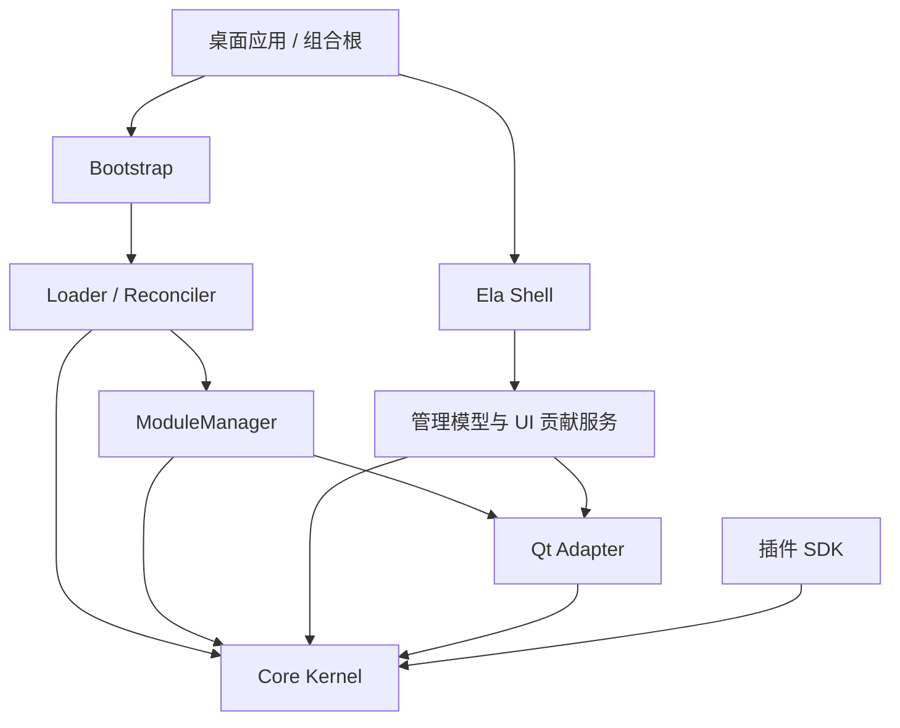
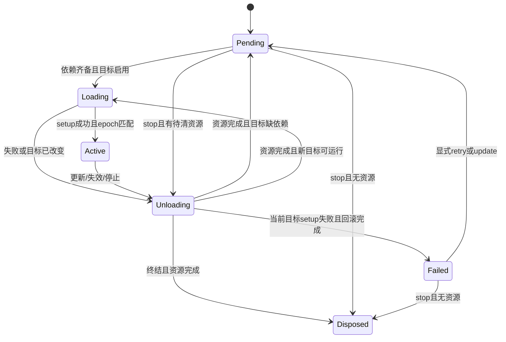
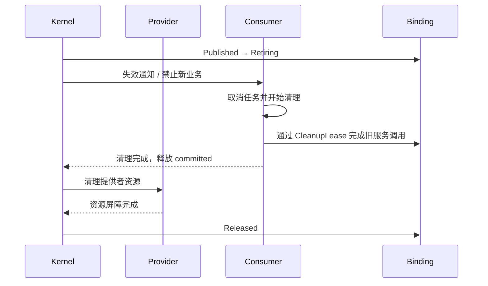

# Cordis 启发的原生插件平台——软件设计说明书

| 项目 | 内容 |
|---|---|
| 文档编号 | CORDIS-CPP-SDD-001 |
| 文档版本 | 1.0，设计评审稿 |
| 编制日期 | 2026-10-23 |
| 目标技术 | C++17、Qt 5.15.2、ElaWidgetTools |
| 首个支持平台 | Windows x64、Qt msvc2019_64、一致的 MSVC/CRT |
| 输入基线 | [开发指南 v1.0](Cordis-Cpp17-Qt5152-开发指南.md)、[研究证据索引](research-evidence.md) |
| 交付性质 | 可实施的详细设计；不代表已经实现、编译或通过测试 |

## 1. 文档约定与设计范围

本说明书将开发指南中的原则细化为模块、状态、数据、接口及异常契约，供内核、SDK、插件、桌面外壳和测试人员共同使用。术语“必须”表示实现及验收要求；“建议”表示可由实现评审调整；“后续”不属于首版验收。

全文没有另行标注的内容均为本项目**设计决定**。引用 P/U/D/Q/E 的事实沿用研究证据索引的核实边界，不能将本设计视为上游 Cordis 的逐行移植。本文示例头文件和算法为设计表达，未编译验证。

### 1.1 产品目标

建立一个以 Context 为访问入口、以实例为资源所有者、以服务绑定变化驱动生命周期的桌面插件平台。平台支持多实例、依赖等待、动态停用、资源清理、配置重建、可诊断的模块驻留，以及可选的受控代码替换。

首版必须支持内置插件、原生服务插件和同工具链 UI 插件。首版不实现任意 JS 表达式、JS Proxy 等价机制、跨机器服务发现或不可信代码沙箱。物理卸载默认关闭；高级卸载与热替换在通过专项验收后开放。

### 1.2 与开发指南的关系及本次细化

| 议题 | 本说明书决定 |
|---|---|
| EffectToken 复制语义 | 可复制控制句柄，析构不撤销；所有副本 close 加入同一任务 |
| InstanceHandle 的等待语义 | mount 返回句柄，等待操作显式区分 active、当前目标稳定、stop |
| 内核依赖 | core 仅依赖 C++17 标准库，Qt 位于 adapter；不依赖 Ela |
| 清理调度 | 组内逆序；组间不能阻塞子实例/消费者停止请求的传播 |
| Context 生命周期 | 插件获得按值能力句柄，内部弱引用实例并固定激活代次 |
| 服务访问 | 通过调用门禁访问，普通引用失效后不能用于新业务 |
| Pending 的等待 | Pending 可为稳定结果，不能无限等待“所有实例 Active” |
| 配置状态 | 区分候选、已接受目标、运行结果和已保存版本 |
| C ABI 配置载荷 | 首版限定 UTF-8 JSON 数据，不跨传 C++ 对象 |

上述细化不修改原开发指南文件；后续实现以本说明书的更具体契约为准。若改动资源归属、状态转换或 ABI，必须更新相应决策和测试。

## 2. 需求及约束

### 2.1 功能需求

| 编号 | 需求 | 验收结果 |
|---|---|---|
| FR-01 | 注册插件定义及创建多个实例 | 配置、effect、生命周期独立 |
| FR-02 | 声明并解析服务依赖 | 缺失时 Pending，出现后激活 |
| FR-03 | 管理服务实现身份和隔离域 | 同名换代触发重建；跨域不串用 |
| FR-04 | 跟踪同步及异步资源 | 可重复 close；清理完成可等待 |
| FR-05 | 支持五类事件分发 | 顺序、终止、错误和 middleware 契约明确 |
| FR-06 | 加载及协调声明配置 | 候选错误不动运行树；部分失败可追踪 |
| FR-07 | 装载原生插件并校验 ABI | 不兼容产物在业务激活前拒绝 |
| FR-08 | 安全停用及保守模块卸载 | 残留资源阻止卸载并列明原因 |
| FR-09 | 提供 Ela 页面、命令和管理界面 | 贡献可撤销，状态可诊断 |
| FR-10 | 提供升级及恢复路径 | 失败后重新激活旧代或显示恢复失败 |
| FR-11 | 正常退出和安全启动 | 按依赖清理；故障插件可隔离禁用 |

### 2.2 非功能需求

| 编号 | 要求 | 验证方式 |
|---|---|---|
| NFR-01 | 内核单写线程，禁止 GUI 阻塞等待 | 线程断言、受控调度测试 |
| NFR-02 | 失活结果不发布，清理不遗漏 | 代次与资源账目断言 |
| NFR-03 | 错误包含实例、条目、操作和阶段 | 结构化日志及管理页测试 |
| NFR-04 | 业务插件不直接依赖 ElaWindow | 构建依赖检查、SDK 边界检查 |
| NFR-05 | 可固定依赖及重现产物 | 构建清单、产物 hash 和版本记录 |
| NFR-06 | 所有清理超时保守驻留 | 故障注入，禁止把超时当成功 |
| NFR-07 | 不设未经测量的性能承诺 | 建立基线后在发布评审确定目标 |

可靠性范围仅覆盖托管 API。网络已产生的结果、数据库提交及绕过接口创建的线程不能自动恢复历史状态。进程内原生插件拥有进程权限，能力检查属于编程契约和审计手段，不是对恶意插件的安全隔离。

## 3. 总体架构与构建边界



箭头表示构建或调用依赖。core 不回调 Qt 类型，通过 IScheduler、IClock、IExecutor 等抽象接口接入。Bootstrap 是宿主可信组合根，具有创建根域、加载模块和关闭内核的权限；普通插件不得获得这些权限。

| 目标库 | 主要类 | 可见依赖 | 对外产物 |
|---|---|---|---|
| cordis_core | Kernel、Context、Instance、EffectScope、ServiceRegistry、EventBus | C++17 | 内置插件及同工具链 SDK |
| cordis_qt | QtScheduler、TimerAdapter、QObjectAdapter、WorkerExecutor | core、QtCore | Qt 资源封装 |
| cordis_loader | ConfigParser、Validator、PlanBuilder、PlanExecutor、ConfigStore | core、QtCore、选定 YAML 解析器 | 配置模型和协调器 |
| cordis_module | ModuleManager、AbiBridge、GenerationLedger | core、QtCore | QLibrary/QPluginLoader 适配 |
| cordis_ui | UiPagesService、CommandService、ContributionRegistry | core、qt、QtWidgets | 与 Ela 无关的 UI 契约 |
| cordis_shell | ElaNavigationAdapter、PluginTreeModel、ConfigEditor | ui、Ela、QtWidgets | 桌面界面 |
| cordis_abi | C 头文件、协议常量 | C 标准整数类型 | 第三方二进制 SDK |
| cordis_app | ApplicationHost、Bootstrap | 上述模块 | 可部署程序 |

YAML 解析器的具体库和版本在实施 P0 选定并审查许可证，不能假定 Qt 自带 YAML。配置内核使用独立的 ConfigValue 树，以免解析器类型泄漏到 SDK。

建议源码结构：

```text
sdk/include/cordis/          C++ 源码接口
sdk/include/cordis_abi/      C ABI 与错误码
src/core/                   内核与无 Qt 单测支持
src/qt/                     调度、对象、定时器、工作任务
src/loader/                 解析、校验、协调、持久化
src/module/                 模块代次、装载、ABI 桥接
src/ui/                     页面和命令贡献服务
app/shell/                  Ela 界面
examples/{builtin,service,ui}/
tests/{unit,integration,abi,ui,stress}/
docs/adr/                   设计决策
```

研究副本不加入 install、插件搜索目录或产品依赖树。

## 4. 领域模型与数据设计

### 4.1 身份模型

所有 id 使用强类型包装，防止混用；进程内递增 id 不复用，溢出按致命错误处理。需要跨启动保存的 EntryId/PluginId 使用受校验字符串，运行期 id 不持久化。

| 身份 | 唯一范围 | 生命周期 |
|---|---|---|
| PluginId | 插件逻辑定义 | 跨构建稳定 |
| RuntimeId | 插件定义 × 模块代次 | 该代次定义存活期间 |
| EntryPath | 配置文件及祖先 id 路径 | 配置条目存在期间 |
| InstanceId | 进程 | mount 至最终销毁 |
| ActivationEpoch | 单个实例 | 每次目标配置/绑定变更递增 |
| BindingId | 进程 | 每次 provide 创建新身份 |
| RealmId | 进程 | 域及相关实例存活期间 |
| OperationId | 进程 | 异步操作及诊断保留期间 |
| GenerationId | 模块产物加载代次 | DLL 驻留期间 |

实例因依赖变化重新激活保留 InstanceId、更新 epoch。条目改变插件类型或模块代次时建立新 InstanceId；旧实例终结后才替换条目当前句柄。

### 4.2 核心记录

| 类型 | 必需字段 | 强所有者 |
|---|---|---|
| RuntimeRecord | runtimeId、pluginId、generation、schema、activate、实例集合 | Kernel |
| InstanceRecord | id、runtime、parent、state、target、epoch、committed、effectScope、failure | Kernel |
| ContextState | weakInstance、capturedEpoch、realmMap、capabilities、mode | Context 值句柄共享 |
| BindingRecord | id、key、owner、epoch、status、service、消费者集合、调用数 | Registry/retired 集合 |
| EffectControl | id、owner、epoch、label、state、setupTask、cleanupTask、children、moduleLease | owner scope |
| ListenerRecord | id、eventKey、owner、epoch、filter、alive、callback、moduleLease | EventBus/分发快照 |
| EntryRecord | path、rawOptions、desiredRevision、instance、lastResult | Loader |
| ModuleGeneration | id、canonicalPath、hash、adapter、state、ledger、pinReasons | ModuleManager |

Binding 状态为 `Staged / Published / Retiring / Released`。Instance 的 ACTIVE 表示 setup 完成且已提交绑定和输出服务；不能仅因“已调用 activate”就视为 ACTIVE。

### 4.3 所有权与循环引用

Kernel 强持有实例，父实例记录子 id 而非形成 shared_ptr 环；Context 只持弱实例引用。Binding 的消费者记录为 id + epoch；实例 committed 表强持绑定租约，退出后释放。ModuleManager 持模块句柄，ModuleLease 只操作宿主控制块，插件对象销毁完成后才减少计数。

插件 std::function、服务对象 deleter、事件载荷均可能包含 DLL 代码。控制块的销毁顺序必须是“先销毁插件对象/回调，再释放 ModuleLease”，不能依赖不明确的结构成员顺序；使用宿主包装类的显式析构完成该顺序。

### 4.4 配置与结果类型

```cpp
using ConfigValue = /* Null/Bool/Int64/Double/Utf8/Array/Object 的带标签树 */;
struct ConfigSnapshot {
    ConfigRevision revision;
    ConfigValue effective;
    std::string canonicalHash;
};
struct TargetSignature {
    ConfigRevision revision;
    RuntimeId runtime;
    std::vector<BindingId> bindings; // 按 ServiceKey 排序
};
struct ErrorInfo {
    ErrorCode code;
    std::string message;
    OperationId operation;
    std::optional<InstanceId> instance;
    std::optional<EntryPath> entry;
    std::string phase;
    std::vector<ErrorInfo> causes;
};
```

配置数值禁止 NaN/Infinity；对象键规范化排序，数组保留顺序。hash 用于发现重复变更，判等仍比较规范化数据，不能只依赖 hash。原始 YAML 文本与行列位置另存 SourceDocument，不写入 effective 树。

## 5. 公共接口与调用契约

### 5.1 Task 与调度器

Task<T> 使用宿主定义的共享完成状态，状态仅 `Pending / Resolved / Rejected`。resolve/reject 可从任意线程提交，通过一次原子仲裁保证只接受一次；所有 continuation 必须异步投递至指定 scheduler，即使任务已完成也不内联执行，以减少重入分支。

```cpp
class IScheduler {
public:
    virtual ~IScheduler() = default;
    virtual bool isCurrentThread() const noexcept = 0;
    virtual bool post(HostClosure) = 0;
};
template<class T> class Task {
public:
    void thenOn(IScheduler&, Success<T>, Failure) const;
    bool isReady() const noexcept;
};
```

以上为接口形状，泛型 void 特化等由 SDK 实现。业务路径不提供阻塞 get。CancellationToken 与 Task 完成独立：取消是请求，只有底层任务确认停止后才算 quiescent。超时结束某次观察任务，不伪造底层完成。

Task 的 continuation 若包含插件回调，必须由 ModuleLease 包装。scheduler 关闭时拒绝新投递；关闭顺序须先 drain 插件任务再销毁 scheduler。无法 drain 的插件保持模块驻留至进程结束，不能先销毁运行时再执行迟到回调。

### 5.2 Kernel 和 Context

```cpp
class Kernel {
public:
    Result<RuntimeHandle> registerPlugin(PluginDefinition);
    Result<InstanceHandle> mount(RuntimeHandle, ConfigValue, MountOptions);
    Task<ShutdownReport> shutdown(ShutdownOptions);
    KernelSnapshot snapshot() const;
};
class Context {
public:
    Result<InstanceHandle> plugin(RuntimeHandle, ConfigValue) const;
    Result<InstanceHandle> inject(DependencySet, Activation) const;
    Result<EffectToken> effect(EffectSetup, EffectOptions) const;
    Result<EffectToken> provide(ServiceDescriptor, OwnedService) const;
    Result<ServiceRef> require(ServiceKey) const;
    Result<Context> isolate(ServiceName, RealmId) const;
    Result<EffectToken> on(EventDescriptor, Listener, EventOptions) const;
};
```

mount 在内核线程完成登记并返回句柄，不等待依赖满足。Context 的写操作仅在内核线程调用；跨线程通过宿主 dispatcher。Context 校验 weakInstance、capturedEpoch、mode 和 capability。过时代次返回 E_STALE_CONTEXT，UNLOADING 创建资源返回 E_CONTEXT_CLOSING。

`inject()` 创建受父实例所有的轻量子实例，可选功能在子实例内运行。parent 停止后不得创建新子实例；失败登记的子实例必须完整撤销，不得留在 registry。

### 5.3 InstanceHandle

| 方法 | 返回与前置条件 | 失败语义 |
|---|---|---|
| requestUpdate(config, expectedRevision) | 校验并建立新目标，返回 operation | revision 冲突不修改状态 |
| stop() | 终结实例；重复调用加入同一终结任务 | 超时通过 observer 报告，不释放底层屏障 |
| retry() | Failed 上清除失败闩锁，建立新 epoch | Disposed 不可恢复 |
| awaitTarget(operation) | 返回对应目标的 StableReport | 被更新覆盖则 Superseded |
| awaitActive(epoch) | 等待指定 epoch ACTIVE | Pending 持续等待；取消/超时为观察结果 |
| snapshot() | 返回不可变状态副本 | 不暴露内部指针 |

StableReport 可为 Active、PendingMissingDependency、Disabled、Failed、Disposed、Superseded。Loader 使用 awaitTarget，不能等待所有条目 awaitActive 导致缺依赖时全局卡住。

## 6. 实例状态机及收敛算法

### 6.1 状态机



Failed 仅表示当前激活失败且回滚已完成。若回滚悬挂，保持 Unloading 并附 `setupFailure` 和 `cleanupBlocked`，不得提前标为 Failed 或 Disposed。disabled 条目由 Loader 不创建实例或 stop 旧实例表示，disabled 不是内核状态。

### 6.2 目标变更处理

1. 接受命令并分配 OperationId；检查 revision 和实例是否已终结。
2. 更新 target，递增 epoch；将实例 id 放入去重 work queue。
3. drain 每轮读取有限数量实例，避免持续变更饿死 GUI；预算在性能测试后设定。
4. 当前动作只运行一次，异步完成再次排队；不递归启动另一个状态转换。
5. 完成回调同时检查 InstanceId、动作序号、epoch；旧动作只能登记和清理自己的资源，不能发布当前服务。

终结意图单调：stop 一经接受，后来的 update 返回 E_INSTANCE_DISPOSED。新代需要新实例。更新期间多个配置只保留最新目标，但被覆盖操作均收到 Superseded，不能永远悬空。

### 6.3 激活算法

解析强依赖 → 固定 committed 租约并加入 dependents → 建立 activation scope → 调用 activate → 等待 setup 完成。setup 中提供的服务为 Staged，实例自身可访问，其他消费者不可见。完成后检查 epoch、所有声明必供服务以及冲突；成功时在一个内核调度步骤发布 outputs 并置 Active，再排队通知消费者。

必供服务不齐视为 E_PROVISION_INCOMPLETE；可选输出必须在 descriptor 单独声明。激活过程不能等待自己新建的、依赖自身尚未发布服务的子实例 Active；这会产生启动屏障环，检测到时拒绝等待并输出路径。

### 6.4 停止与回滚算法

进入 Unloading 时先关闭新业务入口、retire outputs、发出取消，并对所有消费者和子实例发送停止本轮激活的请求。此广播必须先完成，再等待任何清理组。

随后等待消费者和子实例完成需要本实例服务的清理；保留 committed 依赖。清理自身 effect groups，收集全部错误；确认 setup、worker、调用和对象屏障完成。最后释放 committed，移除依赖边，再转入目标稳定状态。

“停止本轮激活”和“最终 stop”不同：依赖失效只结束当前 epoch，实例之后可重激活；用户 stop 终结 InstanceId。子实例由某轮 activate 创建，父轮结束时子 InstanceId 最终终结，下一轮重新创建。

## 7. 服务、隔离域及调用租约

### 7.1 服务描述

ServiceKey 为 `(UTF-8 name, interfaceMajor, realmId)`。Descriptor 包含最低 minor、capability 集合、调用线程策略和生命周期类别。C++ 类型标识仅用于同工具链内部检查；跨 ABI 使用稳定接口 id 与版本，不用 typeid 名称。

RealmMap 对服务名保存显式域覆盖，未覆盖时沿 Context 配置视图继承；默认根域。`isolate(name, realm)` 返回派生 Context，不修改父句柄。同一域同一 key 已有 Staged/Published/Retiring 冲突时按策略拒绝新注册；替换流程必须等旧 binding 完成撤回，不能悄悄覆盖。

### 7.2 索引和依赖图

维护 `key -> binding`、`key -> interested instances`、`bindingId -> consumers`、`parent -> children`。实际依赖边方向定义为“消费者 → 提供者”。停止时消费者先清理；激活时提供者先可用。

声明图用于配置预检，实际图用于资源释放。声明已知的强依赖环直接拒绝；未知提供者保持 Pending。绑定前对新增边做可达性检查，并把 parent 所有权等待关系纳入分析。检测复杂度首版可用 DFS O(V+E)，待基线证明有必要再优化。

### 7.3 普通调用和清理调用

ServiceRef 包含弱 owner、capturedEpoch、bindingId 和接口描述，不允许提取可持久化裸指针。同步 `withService(fn)` 在调用前校验并获得 CallLease，调用后立即释放；异步 `invoke()` 由宿主 request 控制块保持 CallLease 至 completion。

retiring 后普通调用拒绝 E_SERVICE_RETIRING。cleanup 不复用普通 ServiceRef：宿主给 CleanupContext 提供受限的 CleanupLease，仅允许消费者当轮已 committed 的旧 binding，在消费者清理结束前使用。CleanupLease 不能逃逸到下一轮，且不得用于新建业务任务。

自身服务和从父视图继承的服务仍要建立可追踪的使用关系，不能绕过依赖账目。实现可将祖先 committed 关系转借为子 cleanup 租约，但必须在测试中证明父租约不提前释放。

### 7.4 提供者退出时序



## 8. Effect 系统详细设计

### 8.1 接口及状态

```cpp
struct EffectSetupContext {
    Result<void> addCleanup(CleanupFunction); // 获得资源后立即登记
    CancellationToken cancellation;
};
using EffectSetup = std::function<Task<void>(EffectSetupContext&)>;
class EffectToken {
public:
    Task<CleanupReport> close() const;
    EffectSnapshot snapshot() const;
};
```

EffectSetupContext 在 setup 任务期间由宿主持有，插件不得长期保存其裸引用。状态为 SettingUp、Live、Closing、Closed；失败信息与资源状态分开记录，避免 Failed 掩盖尚未清理资源。

### 8.2 登记与关闭

先创建控制块并加入 owner scope，再执行 setup。close 设置 closingRequested，并取消 setup；setup 尚未结束时等待其完成屏障。后到的资源仍登记到控制块，但立即进入清理队列。setup 成功则 Live，若已请求 close 则直接 Closing；setup 失败则保留原始错误并关闭所有已登记资源。

组合 effect 中收集的 cleanup 逆序执行。一个 cleanup 抛错或 reject 后记录错误，继续下一项。close 的所有调用共享同一个 cleanupTask。只有资源完全释放才移除 owner 中的控制块；失败且不能证明释放时保留诊断及模块 pin。

### 8.3 避免清理依赖死锁

不能先串行等待某个业务 cleanup，再向它需要的子任务发取消。进入关闭时采用两个步骤：第一步向所有关联控制块、子实例及 worker 广播 requestClose；第二步按依赖约束等待并执行 cleanup。组内逆序不覆盖消费者优先约束。

清理函数不得等待自身 close task，不得等待依赖于自己完成才能停止的祖先。Task 等待关系由 debug 模式记录，已知环输出 E_CLEANUP_CYCLE。未知或不合作外部任务以超时诊断并保守驻留处理。

### 8.4 适配器责任

| 资源 | 创建时登记 | 完成证据 |
|---|---|---|
| QTimer | timer 停止/删除函数和目标线程 | destroyed + 回调载荷释放 |
| QObject connection | connection 和 gate | disconnect + 所有托管在途回调完成 |
| QObject | owner、亲和线程、销毁策略 | destroyed 信号确认 |
| worker | cancel source、join 状态、模块 lease | 线程/任务实际退出 |
| watcher | 监听范围、停止函数 | 监听器销毁和排队通知失效 |
| UI 页面 | 页面 handle、导航 token、factory lease | 导航移除与页面对象销毁确认 |
| 文件/句柄 | 明确 close 函数 | 关闭成功；失败保留残留说明 |

## 9. EventBus 详细设计

EventDescriptor 固定事件 id、参数 schema、返回协议、realm/filter 规则和允许的分发模式。同一个 id 的不兼容声明拒绝。首版事件参数为宿主拥有的 ValueTuple，跨线程仅允许宿主类型；类型化 C++ wrapper 在调用前编码/校验。

ListenerRecord 登记必须归属于 effect。分发取得 listener 句柄快照；调用前再检查 alive、owner epoch 和 scope filter。snapshot 强持 control，因此注销后不再执行，但闭包在快照销毁前仍可能驻留模块。

| 分发 | 成功行为 | 错误行为 |
|---|---|---|
| emit | 按序同步执行全部 | 遇错误停止并返回 ErrorInfo |
| bail | 首个 Stop(value) 返回 | 同步错误停止；禁止返回 Task |
| serial | 逐个等待，首个 Stop 返回 | 首个失败结束本次分发 |
| parallel | 启动合格 listener，等待全部 | 收集全部错误，顺序按 listener id |
| waterfall | next 调用下游，允许 veto | next 重复/逃逸使用返回 E_NEXT_INVALID |
| post | 复制参数后投递，抵达时重新检查 | 过期记诊断计数，不执行业务 |

once 在进入 callback 前置 alive=false。prepend 只改变注册位置，默认按注册顺序；不提供首版复杂优先级。新监听器不加入当前分发。内部状态事件单独使用 ObserverBus，逐个隔离错误，避免管理页异常破坏生命周期。

waterfall 的 Next 在当前同步调用栈结束后失效，不允许保存后调用。JS 的 0/空字符串终止语义在 C++ 中用 Stop 显式表达，属于有意的 API 映射，不能靠 QVariant 真值模拟。

## 10. 配置、Loader 与持久化

### 10.1 配置协议

顶层字段为 formatVersion、modules、plugins；未知结构字段拒绝，插件 config 字段由插件 schema 决定。首版拒绝 `!!js` 和自定义可执行 tag，限制别名展开、嵌套深度和输入大小；具体限额在配置策略中显式设置。

```yaml
formatVersion: 1
modules:
  storage: { manifest: "plugins/storage/manifest.json" }
plugins:
  - id: storage-main
    plugin: org.example.storage
    module: storage
    disabled: false
    config: { path: "data/notes.db" }
  - id: notes-main
    plugin: org.example.notes
    module: builtin
    inject: [storage/v1, ui.pages/v1]
    config: { title: "我的笔记" }
```

该格式继承指南示例并补充 modules 映射。字符串 `storage/v1` 是简写，内部解析为 name=storage、major=1。realm 使用独立字段映射，不能在字符串中隐式解析任意脚本。路径以配置目录为基准规范化，manifest 中库路径以 manifest 目录为基准；部署模式下必须限制在允许的安装根内。

Entry 的 inject 只能增加或收紧插件定义需求，不能删除插件必需依赖。配置 disabled 为严格布尔；父禁用级联子条目。初版支持显式 children 树，不支持跨文件循环 include；include 作为后续扩展。

### 10.2 数据阶段

| 阶段 | 内容 | 变更条件 |
|---|---|---|
| SourceCandidate | 用户文本、文件 revision、位置 | 编辑或 watcher 发现 |
| ValidatedCandidate | 结构、schema、定义校验通过 | 所有候选校验完成 |
| DesiredSnapshot | 用户接受的完整目标 | CAS 检查后接受计划 |
| RunningSnapshot | 每条实际代次/配置和状态 | 实例动作完成 |
| PersistedSnapshot | 已落盘的目标及 revision | 原子提交成功 |

用户接受的目标即使某条启动失败也可保存，启动失败不能偷偷丢弃用户意图；UI 同时显示“目标已保存”和“运行未完全收敛”。用户点击恢复旧版本时创建新目标 revision，仍走正常 reconcile。

### 10.3 计划构造与执行

PlanBuilder 使用 EntryPath 比较目标：新增 Add、删除 Remove、禁用 Disable、类型/模块/realm/依赖变化 Recreate、普通配置变化 Restart、完全相同 NoOp。首版不实现 volatile；保留 HotUpdate 操作类型但默认返回 unsupported。

每个 Plan 包含 baseDesiredRevision、candidateHash、orderedOperations、affectedClosure、预检诊断。独立操作采用稳定 EntryPath 排序；移除按消费者先，添加按提供者先。未满足动态依赖的新增结果为 Pending，不阻塞无关条目。

全局只执行一个 Plan。执行期间新的候选可解析，但不得并发修改运行树；当前动作到安全检查点后停止旧计划，旧结果标 Superseded，基于实际运行树重建最新计划。显式 stop 和应用退出优先于配置计划。

每个操作记录 `NotStarted / Running / Applied / Pending / Failed / Skipped / Superseded`。激活失败默认停止后续可能依赖该条目的操作，无关条目策略由 plan 的 stopOnError 选项固定；首版默认全计划停止继续执行，保留已生效部分，不宣称全局回滚。

### 10.4 持久化、冲突及 watcher

ConfigStore 通过单写队列提交完整目标，使用 Qt 层的同目录临时文件提交机制；实现选用 QSaveFile 等接口前须核实目标版本行为。提交前比较磁盘基线 hash：外部变更时返回 E_CONFIG_CONFLICT，保留两份候选供用户选择，禁止静默覆盖。

提交完成后更新 persistedRevision 和 hash；失败保留 dirty 状态，可重试。watcher 监听目标及父目录，合并通知，rename 后恢复目标监听。自身写入通知以 hash 消重；外部快速连续修改最终应收敛到最后一次完整读取，不依赖固定数量的文件事件。

首版配置编辑器保存规范化 YAML，不承诺保留原注释和原排版；保存前预览差异。精确保留注释需要另行选定 round-trip parser 后扩展。

## 11. 原生模块与 ABI

### 11.1 Manifest

```json
{
  "manifestVersion": 1,
  "moduleId": "org.example.storage",
  "moduleVersion": "1.0.0",
  "loader": "c-abi",
  "library": "storage.dll",
  "sha256": "实际产物的64位十六进制摘要",
  "platform": "windows-x64",
  "abi": { "major": 1, "minor": 0 },
  "plugins": ["org.example.storage"],
  "unloadPolicy": "resident"
}
```

示例摘要是说明占位，实际校验必须拒绝它。Qt UI 模块额外包含 Qt 精确版本、compiler build id、CRT、buildMode 和 Ela/SDK 兼容标识。manifest/hash 不构成恶意代码认证，发布签名及信任策略是部署扩展。

预检顺序：大小/格式 → 路径/平台 → 产物 hash → 装载适配器 → query/interface → ABI/descriptor → 注册 Runtime。库装载可能运行 DLL 静态初始化，因此“query 无副作用”不意味着加载阶段无任何代码执行；插件作者必须保持静态初始化无业务资源，不合规模块固定驻留。

### 11.2 C ABI 函数表设计

以下为布局草案；发布前必须形成独立、可由 C 编译器验证的头文件及布局测试。首版仅支持 Windows x64，自然平台布局，不使用任意 `pack(1)`；结构偏移和 sizeof 形成 ABI 测试基线。

```c
#include <stdint.h>
typedef uint64_t CordisHandle;
typedef uint64_t CordisRequestId;
typedef int32_t CordisStatus;
typedef struct CordisBytesV1 {
    const uint8_t* data;
    uint64_t size;
} CordisBytesV1;
typedef struct CordisTableHeaderV1 {
    uint32_t struct_size;
    uint32_t abi_major;
    uint32_t abi_minor;
    uint32_t reserved;
} CordisTableHeaderV1;
/* 实际头文件统一给入口和全部函数指针添加 CORDIS_CALL(__cdecl)。 */
typedef struct CordisPluginApiV1 {
    CordisTableHeaderV1 header;
    CordisStatus (*create)(CordisHandle host_context,
                           CordisBytesV1 config_json,
                           CordisHandle* instance);
    CordisStatus (*start)(CordisHandle instance, CordisRequestId request);
    CordisStatus (*request_stop)(CordisHandle instance, CordisRequestId request);
    CordisStatus (*destroy)(CordisHandle instance);
} CordisPluginApiV1;
```

入口 `cordis_query_v1(hostAbi, hostTable, outPluginTable)` 使用 C linkage、显式导出，out 表由宿主预填容量；插件只写 min(宿主容量, 自身表长度)。header major 必须匹配，minor 通过 size 与 capability 协商。所有 reserved 必须为零。

HostTable 必须提供以下函数族，签名冻结时配套参数所有权表：

| 函数组 | 必需能力 | 所有权与约束 |
|---|---|---|
| complete | request id、status、结果 JSON | 调用期间借用，返回前宿主复制；恰好接受一次 |
| log | 级别、实例句柄、UTF-8 文本 | 同步复制，不能持有插件字符串 |
| dispatch | callback id、宿主复制的数据 | 句柄受 epoch 校验，payload 不含 C++ 对象 |
| service | register/withdraw/invoke/complete | 统一 key 与请求协议；注册归属 effect |
| effect | 创建/完成/请求清理记录 | cleanup 由模块回调表分派，持有 ModuleLease |
| buffer | 如需大数据时显式分配/释放 | 首版 JSON 同步复制，后续扩展才允许共享缓冲 |

create 为同步、轻量且不允许等待事件循环，config_json 仅在调用期间有效，需保存则插件自行复制。start/request_stop 若返回 PENDING，必须后续 complete；若返回 OK 或错误则不得再 complete。重复或未知 request id 记录 E_ABI_PROTOCOL，宿主不重复推进状态机。取消不免除完成义务。destroy 仅在停止和所有请求屏障后调用；失败时保留实例及模块。

所有异常在插件边界捕获，输出错误码和宿主复制的错误详情。句柄只在所属进程/代次有效，宿主表在模块彻底终结前有效。C ABI 服务调用同样使用复制数据或函数表，不把内部 ServiceRef 传给插件。

### 11.3 Qt UI 插件

Qt UI 使用同工具链的 IQtPluginV1 和 QPluginLoader；root plugin object 代表工厂，不代表每个业务实例。每个 activate 创建独立的页面/业务实例，destroy 清理业务对象；root 对象销毁服从 loader 契约，业务层不得擅自 delete root。

Qt/Ela 类型只能通过锁定工具链的 UI 契约传递，不能混入 C ABI。UI 工厂、虚表、元类型和 Qt 静态注册可能阻止卸载，首版 Qt UI 模块固定 resident，即使页面已删除也不自动尝试卸载。

### 11.4 ModuleGeneration 状态和账目

状态为 `Discovered / Validated / Loaded / Serving / Draining / Resident / Unloaded / Failed`。业务实例状态与模块状态独立；一代模块可同时含多个实例。

Ledger 按类别计数并保留记录 id：instances、setupTasks、cleanupTasks、calls、workers、callbacks、queuePayloads、serviceObjects、qobjects、externalHandles。另有不能通过计数解除的 pinReasons，如 untrackedStaticRegistration、uncertainCleanup、unsupportedUnloadPolicy。

只有所有可执行引用归零、无 pin、适配器支持卸载、配置明确允许时进入 unload 尝试。unload 失败保留 Loaded/Resident 及错误；模块管理不能释放自身控制块假装成功。QPluginLoader 的默认 PreventUnloadHint 事实见 Q1，改变 hint 也不是安全证明。

## 12. 受控替换与恢复

ReplacementOperation 持有旧/新 generation、受影响条目、旧配置快照、当前阶段和恢复报告。每个模块最多一个替换操作；运行期间配置计划对受影响闭包加逻辑操作锁，界面可编辑但不能同时应用冲突命令。

流程：

1. 将新产物复制至 hash 命名目录，预检并加载新代工厂；不覆盖旧 DLL。
2. 验证新代 PluginId、服务 major、schema 兼容性；失败直接保留旧代运行。
3. 冻结闭包的新业务，取消/清理依赖消费者，再停止旧代实例。
4. 旧代清理完成后创建新实例，使用新 schema 校验配置并等待激活结果。
5. 成功则提交 entry→newInstance 映射，恢复消费者和后台工作。
6. 失败则清理新实例，使用保留旧代和旧配置重新激活，再恢复消费者。
7. 恢复也失败时显示 RecoveryFailed、停止闭包；保留所有仍有引用的代次。

新代 staging 输出对受影响闭包外不可见，发布边界由替换协调器控制；首版可通过宿主 hold 标志延迟发布。消费者恢复仍可能失败，必须纳入 ReplacementReport，不能仅凭提供者 Active 宣称升级成功。

如果旧代不能清理，新代不得接管相同服务键。允许用户退出并重启，但不得通过强杀线程或强制 FreeLibrary 尝试恢复。持久状态迁移必须是版本化数据、先校验再提交；旧指针、QObject 和 STL 对象不能迁移。

## 13. 线程、队列及 Qt 资源

GUI 主线程也是 KernelThread。Registry、生命周期、配置运行树和 UI 贡献表仅该线程写入。Worker 只处理可独立取消的计算/IO；回主线程的数据必须为宿主定义的不可变值。

异步提交携带 `(InstanceId, Epoch, OperationId)`。到达时检查：实例存在 → epoch 匹配 → 是否仍接受业务 → request 未完成；失败时释放 payload 并更新丢弃计数。释放前仍保持原模块 lease，不能因“丢弃执行”就先卸载代码。

QObject 在亲和线程创建和销毁。对象适配器以 destroyed 确认屏障，不把 deleteLater 调用完成视为对象已销毁。禁止 GUI 等待 future.get、阻塞 join 和 BlockingQueuedConnection。线程退出前完成该线程对象清理；事件循环停止后不能再依赖其处理 deferred delete。

资源回调可从任意线程到达 HostTable.complete，但只能修改宿主请求原子状态并投递内核，不直接触碰 registry。跨模块代码调用必须持 CallLease，跨线程回调也一样。

## 14. Ela 界面及交互设计

### 14.1 UI 服务

| 服务 | 输入 | 返回及撤销 |
|---|---|---|
| ui.pages/v1 | 稳定 contributionId、标题、父类别、页面工厂 | PageHandle 和 effect token |
| ui.commands/v1 | 命令 id、标题、执行回调、启用谓词 | CommandHandle；撤销后禁止新执行 |
| ui.notifications/v1 | 级别、文本、关联操作 | 无插件对象持久引用 |
| diagnostics/v1 | 过滤条件 | 只读不可变快照 |

UI 服务不能把 ElaWindow 暴露给普通插件。页面贡献 key 由宿主保存；贡献 id 限定在实例命名空间。页面工厂可懒创建，但工厂存活仍计入模块引用。父贡献移除时先处理其插件子贡献，不删除其他实例拥有的页面。

### 14.2 页面关闭流程

设置 contribution retiring → 拒绝新导航/命令 → 当前页切到宿主安全页 → 关闭弹窗/独立窗口 → 移除导航节点 → 断开托管连接 → 按所有权删除页面 → 等待 destroyed → 销毁工厂闭包 → 释放模块 lease。

Ela removeNavigationNode 的存在已核实（E2），其页面所有权细节仍需适配测试。实现必须只选一个页面删除责任方，禁止 Ela 与平台双重拥有导致双删。阻止关闭的编辑内容须在业务停用前给出保存机会；系统退出超时策略由用户选择，不能在 cleanup 中弹出永不完成的模态确认。

### 14.3 管理界面

插件列表展示条目路径、名称、运行状态、目标配置版本、模块代次和最近错误。详情分为依赖、资源、配置、日志、模块引用。操作按钮按状态启用：Pending 可查看缺依赖，Failed 可重试，Unloading 只可查看等待原因，Disposed 只能由配置重新创建。

配置页显示候选差异、校验结果、将重启的闭包、已保存版本和部分失败结果。操作使用 OperationId 跟踪，防止用户双击提交并发计划。物理卸载默认不展示普通快捷按钮，仅高级诊断中显示“符合条件后尝试”。

## 15. 启动、退出与故障恢复

### 15.1 启动

加载宿主设置与构建清单 → 建立 scheduler、日志和 Kernel → 注册根服务 → 建立 UI 服务及 Ela 外壳 → 解析模块 manifest 与配置 → 校验计划 → mount 条目 → 显示所有 StableReport。某条缺依赖不阻止管理界面出现。

宿主启动标记记录 session id 和上一轮是否正常关闭。异常退出后提供安全模式：仅加载宿主服务和管理界面，保留用户配置，在用户选择后逐个恢复插件。该标记用于诊断，不等于可靠识别具体崩溃插件。

### 15.2 正常退出

停止接收配置/替换操作 → 结束或 supersede 当前计划 → 刷新已接受配置的写队列 → 停止业务根实例 → 等消费者/子实例/effects/worker → 销毁 UI 贡献 → 输出驻留及残留报告 → 释放可安全释放模块 → 关闭日志 → 最后停止 scheduler/Qt 事件循环。

退出超时提供“继续等待”或“退出进程”；进程退出的 OS 回收不能记为正常插件卸载通过。应用不提供强制终止某个进程内线程的按钮。

## 16. 错误、诊断与审计

| 错误码 | 含义 | 默认处理 |
|---|---|---|
| E_STALE_CONTEXT | 句柄代次过期 | 拒绝调用，记录调试信息 |
| E_CONTEXT_CLOSING | 清理中创建资源 | 拒绝，附 owner 和 effect label |
| E_DEP_MISSING / E_DEP_VERSION | 依赖缺失/不兼容 | Pending，列出 key 与候选 |
| E_DEP_CYCLE | 依赖或等待环 | 拒绝目标，输出路径 |
| E_SERVICE_CONFLICT | 同域同键重复提供 | 当前激活失败并回滚 |
| E_SERVICE_RETIRING | 旧服务不接新业务 | 返回可处理错误，不访问对象 |
| E_ACTIVATION_FAILED | setup 失败 | 清理后 Failed |
| E_CLEANUP_FAILED / E_CLEANUP_TIMEOUT | 清理失败/等待超时 | 汇总、驻留、禁止卸载 |
| E_CONFIG_INVALID / E_CONFIG_CONFLICT | 候选无效/外部冲突 | 不覆盖，保留候选 |
| E_ABI_MISMATCH / E_ABI_PROTOCOL | 表不兼容/请求协议违规 | 拒绝激活或隔离模块 |
| E_MODULE_PINNED | 卸载条件不满足 | 列出具体引用/静态 pin |
| E_RECOVERY_FAILED | 旧代恢复失败 | 停止闭包，要求人工处理 |

日志字段包括 session、operation、entry、instance、epoch、binding、generation、phase、duration 和 errorCode。配置按 schema 的 secret 标记脱敏；错误不得包含凭据。高频重复事件聚合计数，不抑制第一次错误或状态变化。

诊断快照用宿主 DTO，不含 DLL 对象、可调用闭包或裸地址。日志保存限额、轮转和保留期限由宿主设置配置，默认值在发布前确定。

## 17. 部署和版本管理

安装目录区分 app、runtime、plugins/hash、schemas；用户可写配置、缓存和日志放用户数据目录。配置默认不得修改应用 DLL。ModuleManager 是唯一动态库装载入口，规范化路径并限制搜索范围。

C++ 源码 SDK 与 UI 插件使用相同编译器/CRT/Qt/DebugRelease 组合；C ABI 用布局与协议测试维护兼容性。PluginVersion、ConfigFormatVersion、SchemaVersion、AbiMajor/Minor 分开管理，不能用一个版本号同时代表所有兼容关系。

部署包输出 build-manifest：目标平台、编译器、Qt、Ela 提交、SDK ABI、插件 hash 和许可证清单。配置迁移先备份并验证，迁移失败保留旧配置；升级程序不覆盖驻留 DLL，旧 hash 目录在确认未使用后由后续启动清理。

## 18. 测试与需求追踪

本节为待实施验收计划，不表示现有测试通过。沿用开发指南 C/D/E/L/A/H/Q/U 编号，并新增设计级测试 S。

| 需求/设计 | 对应测试 | 核心断言 |
|---|---|---|
| FR-01 多实例 | D04、S01 | 一个实例重启不改其他实例资源 |
| FR-02/03 依赖 | D01–D05、S02 | 新绑定 id 驱动失效；旧 cleanup 可读旧服务 |
| FR-04 effect | C01–C04、S03 | setup 前登记；晚到资源清理；共享 close 结果 |
| FR-05 event | E01/E02、S04 | once 重入、注销快照、next 逃逸均正确 |
| FR-06 配置 | L01–L04、S05 | supersede 不悬挂；保存目标与运行失败可并存 |
| FR-07 ABI | A01/A02、S06 | C/C++ 双编译布局；重复 completion 不二次转换 |
| FR-08 卸载 | A02、Q01、S07 | payload/deleter 最后释放前不得卸载 |
| FR-09 UI | U01、S08 | 工厂闭包/独立窗口一起清理，导航不双删 |
| FR-10 替换 | H01/H02、S09 | 新代失败、旧代恢复失败分别准确报告 |
| FR-11 启停 | S10 | 部分缺依赖可启动管理页；退出保持事件循环至 drain |
| NFR-01/02 | Q01、C03、S11 | worker 迟到与 GUI 关闭无悬空访问/死锁 |

新增场景：S02 检测 parent/child 加依赖等待环；S03 setup 内重入 stop 且随后登记 cleanup；S05 plan A 执行期间候选 B/C 到达，最终运行及 desired 为 C，A/B 均有终结结果；S06 stop PENDING 后取消但仍晚到 completion；S07 失活 callback 不执行但其捕获析构仍在 DLL；S09 消费者恢复失败也使替换报告非成功。

单测使用 FakeScheduler/FakeClock 和显式 gate，不依赖 sleep 推测竞态。集成测试使用真实 Qt 事件循环和测试 DLL。压力测试随机组合 mount/update/withdraw/stop，保存 seed；100 次替换后检查所有资源分类账、对象/句柄以及驻留原因，而不只比较进程内存总量。

发布门禁：所有必需测试通过；无未解释资源残留；ABI 布局基线一致；Debug/Release 各自运行匹配插件；关键异常路径有故障注入。物理卸载必须额外通过专项测试并按模块白名单开放。

## 19. 实施工作包与退出条件

| 阶段 | 工作包 | 可评审交付 | 退出条件 |
|---|---|---|---|
| P0 | ADR、类型/错误码、Task、配置解析器和工具链选型 | SDK 草案、状态测试模型、依赖清单 | 本文关键契约无冲突，布局草案完成评审 |
| P1 | Kernel、Context、Instance、Effect、Event | 内置定时插件示例 | C/E 基础用例及 S01/S03/S04 通过 |
| P2 | Binding、Realm、Call/CleanupLease、依赖图 | 存储提供者和消费者 | D 全部及 S02 通过 |
| P3 | Loader/Store、Qt adapters、UI 服务与 Ela 管理页 | 笔记示例和配置预览 | L/Q/U 及 S05/S08/S10 通过 |
| P4 | ModuleManager、ABI 桥、驻留账目 | 服务 DLL、同工具链 UI DLL | A 及 S06/S07 通过，默认驻留可发布 |
| P5 | ReplacementOperation、状态迁移、恢复和卸载白名单 | 在线升级演示与故障报告 | H/S09 和专项压力测试通过 |

## 20. 待核实项与设计评审清单

| 项目 | 当前状态 | 实施前动作 |
|---|---|---|
| 上游 intercept/shadow/receiver 完整语义 | 未完整移植 | 若纳入范围，逐项设计及回归 |
| Task 内存/关闭行为 | 本文设计，未实现 | 验证跨线程完成、scheduler 拒绝和闭包析构 |
| C ABI HostTable 完整函数签名与布局 | 详细协议草案 | 形成独立头文件、样例 DLL 和布局测试 |
| Ela 页面所有权和独立窗口行为 | 待适配验证 | 阅读固定实现并做双删/泄漏测试 |
| Qt 精确版本适配器与部署 | 未编译 | 固定 kit 后进行真实构建与资源实验 |
| YAML 限额、注释保留与保存策略 | 契约已定，库待选 | 选库并验证错误位置与输入限额 |
| 线程、退出和不可合作插件 | 设计边界明确 | 实施超时与保守驻留故障注入 |
| 性能、内存与停机目标 | 未测量 | 建立 P1/P2 基线后设发布阈值 |

评审应重点确认：所有资源是否有 owner；所有异步结果是否有 epoch；每个清理等待是否存在潜在环；服务退出是否先退发现入口再释放旧租约；模块引用是否覆盖回调与析构；配置计划是否可说明部分结果；管理界面是否准确显示驻留和保存状态。

## 附录 A. 研究来源追踪

本文依赖的事实沿用 [research-evidence.md](research-evidence.md) 中固定版本，证据编号保持不变：

| 设计主题 | 研究来源 | 本文对应 |
|---|---|---|
| Context / Runtime / Fiber | P1、U1/U2 | §4–6 |
| Effect 与重入关闭 | U1/U3、D2 | §8 |
| 服务旧绑定存活和域 | U4/U5/U6 | §7 |
| Event 分发契约 | U7/U8 | §9 |
| Loader 身份及部分生效 | U9、D1/D3 | §10 |
| 模块替换恢复边界 | D4 | §12 |
| Qt 卸载、对象和线程约束 | Q1/Q2/Q3 | §11/13/15 |
| Ela 构建与导航接口 | E1/E2 | §3/14/17 |

## 附录 B. 建议冻结的设计决策

ADR-001 Context 托管入口；ADR-002 GUI 单写调度；ADR-003 BindingId 变化驱动重建；ADR-004 逻辑停用与物理卸载分离；ADR-005 配置计划非全局事务；ADR-006 C ABI 数据边界；ADR-007 Ela 隔离于 shell；ADR-008 自有 C++17 Task；ADR-009 EffectToken 析构不关闭；ADR-010 Pending 是可报告稳定态；ADR-011 清理先广播再按依赖等待；ADR-012 UI 模块首版固定驻留。
