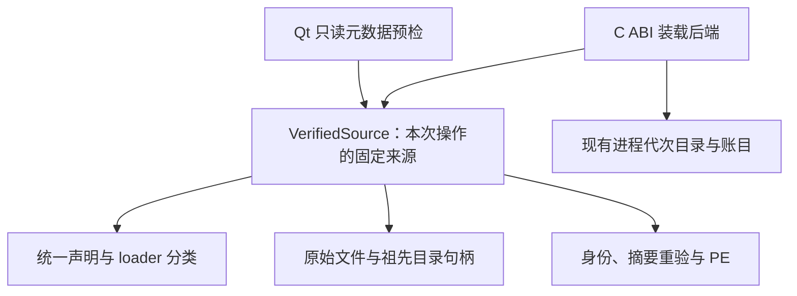

# ADR-0037：Qt 模块边界与渐进实现

日期：2026-10-29。状态：采用。用户要求后续开发先考虑职责和所有权，避免向已有入口持续叠加分支。

## 职责与依赖

模块分成三层：产物验证处理声明、路径、文件身份、摘要和 PE；装载后端处理 C ABI 或 QPluginLoader 的不同协议；实例适配把已验证工厂接到 Core 与已有页面资源服务。Core、配置 Session、Ela 普通页面服务不依赖任何装载后端。

本次 M4a 把已有固定来源流程提取为 VerifiedSource，C ABI 装载和新增 Qt 只读预检共用。Qt 预检只返回宿主值，不创建代次、调用 load/instance 或缓存 QObject；因此不引入第二套目录。manifest 只增加明确的 loader 类型，原生后端显式拒绝 Qt 类型，避免宽化公共解析后意外走错装载协议。

Qt 工具链声明位于插件嵌入元数据，包含 SDK/Qt、编译器版本、CRT、迭代器调试级别、指针宽度和 C++ 标准；同时核对 Qt 自带版本/debug、IID 和 manifest 身份/插件目录。声明校验不是任意工具链二进制互通证明，最终工厂契约仍在 M4b 验证。仅支持当前 Windows x64 / MSVC / Qt 5.15.2 / 动态 CRT 组合。

后续 M4b 提取现有进程代次目录的公共职责，接入 QPluginLoader 后端；不复制 Registry/Generation 或复用 C ABI HostTable 传 QWidget。root 工厂归 QPluginLoader 管理；每次激活的 QWidget/业务对象归实例资源层管理。通过现有 PageHandle/QObjectResource 的完整析构屏障，再释放工厂闭包和模块租约；清理不确定时保留对象与引用。首版固定 resident，不手动 delete root 或调用 unload。

M4c 再装配页面示例、管理诊断和 UI 退出验收。只在实际第二个后端需要时提取目录接口，不先建立通用插件框架、空实现或大量预留扩展点。

## 验证组织

Qt 预检使用独立测试入口，复用测试产物安装设施，不再往 native 测试主文件增加 Qt 分支。既有 C ABI 装载及路径/共享/篡改/代次回归保护 VerifiedSource 提取；真实 Qt 元数据 DLL 验证兼容性拒绝和无映射/无实例副作用。

Qt 的元数据查询与 root 所有权依据 [QPluginLoader 官方文档](https://doc.qt.io/qt-5/qpluginloader.html)，同时核对本机固定版本头。M4a 不等于 Qt 工厂、页面或 P4 整体完成。

## M4b1 实施细化

2026-10-29：第二个后端实际接入时，提取 catalog.cpp 为两个后端共用的唯一代次目录和受限 Windows 映像映射。原生管理器保留自己的描述握手；Qt 使用自己的 QPluginLoader 与 root 驻留所有者。共同错误信号不依赖目录/Windows/Qt，业务请求层无需知道 Qt 装载器。

M4b 分为 root 装载与业务工厂两次提交：b1 的 loadQtModule 只建立真实映像/root，诊断不标记 descriptorAccepted/businessAccepted；b2 才冻结 IQtPluginV1 业务契约并接实例。root 的真实 QObject 租约保持登记且阻止 drain，首版不以手动删除 root、调用 unload 或清空账目取得假退出。模块默认驻留与每次业务激活的完整退出分开验收，详见 [实施记录](../p4-m4b1-development.md)。
