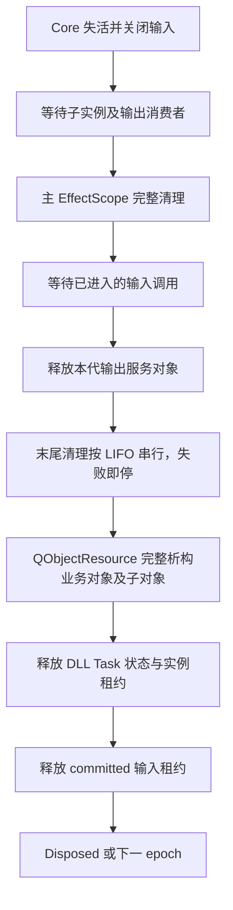

# ADR-0038：同工具链共享 Core 与业务对象末尾清理

日期：2026-10-30。状态：采用。承接 [模块边界](0037-qt-module-boundaries.md)。

## 问题与取舍

Qt 业务工厂直接链接静态 Core 会复制 Runtime/Instance/realm 等身份分配器；同一源码并不代表同一进程状态。Qt 插件和宿主必须调用同一个 Core DLL。Windows/MSVC/Qt 构建默认 CORDIS_SHARED_CORE=ON，Core 不增加 Qt 依赖；无 Qt 构建默认使用静态 Core。公开 SDK 暂无导入的全局数据，采用 CMake WINDOWS_EXPORT_ALL_SYMBOLS 导出函数；该 C++ SDK 仍要求相同源码/工具链，不构成稳定二进制 ABI。若以后增加公开数据符号，须明确 dllimport，不能假定自动导出已经解决数据导入。

Core DLL 与应用位于原构建目录的 bin，Debug 使用 d 后缀；共享 Core 和插件 SDK 均拒绝 /MT 编译。root 装载入口也调用实际 Core 的 buildInfo 核对 SDK 版本、编译器类别和指针宽度，使仅使用装载入口的宿主也明确导入共享 Core。Qt 插件通过 Cordis::QtPluginSdk 只链接共享 Core 和 QtCore，不链接模块目录/宿主实现。显式关闭共享 Core 时保留原生 C ABI 和只读 Qt 预检，关闭 Qt 业务适配目标。C ABI DLL 的接口及默认驻留策略不变。

普通 onCleanup/effect 并行清理，不能在那里直接删除仍被页面/worker/服务对象使用的业务 QObject。采用通用 Context::afterCleanup，复用独立 EffectScope 与现有 EffectToken：等待子实例、主作用域和在途输入调用；释放本代输出对象；随后按登记逆序逐个关闭末尾清理，前一项真正成功后才推进。失败保留当前及更早的所有者，不并行、不越过失败继续析构。最后才释放输入 committed 租约，保持消费者完整退出先于提供者清理的既有约束。

afterCleanup 不返回可提前关闭的句柄，也不授予 CleanupContext 或业务访问权限。InstanceSnapshot 分别保留末尾清理账目/阶段，hasRetainedResources 包含两阶段；配置检查点与管理页不能只看主作用域是否为空。调度器关闭不伪造完成。

## Qt 适配

IQtPluginV1 在实际 qobject_cast、Core 身份和目录核对后才被接受。Core 身份由 DLL 内的虚调用返回其实际 Core 的只读地址，宿主比较自己的 Core 身份，不能仅凭 SDK 目标名或元数据声明假定同一份 Core；默认虚方法须保留动态分派，不能在宿主限定调用基类内联实现。真实静态 Core 构建已由生产握手拒绝，且没有调用插件目录或创建业务对象。IQtInstanceV1::activate 接受普通 Context。每次 epoch 都由工厂创建独立、无 parent、应用线程的业务 QObject；工厂创建不重入，外部构造/接口转换返回后复查 Context，创建中停止或更新的旧代只清理，不再 activate；根工厂归 loader，不能返回 root 或共享活动对象。

宿主在调用工厂之前登记业务末尾清理；插件后登记的末尾清理先执行，失败会保留业务对象。普通资源通过既有 effect、QtConnection/QtWorker、UiPagesService 等完整释放。随后 QObjectResource 确认整个 delete 调用和子对象析构结束，再释放 DLL Task 状态与 Instance/CleanupTask 租约；Runtime 定义独立持 ExternalHandle，根工厂的 QObject 租约继续按进程驻留策略保留。

正常创建拒绝/激活失败可以按 Core 回滚。普通资源或末尾清理失败保留该实例，配置不能继续安全替换；工厂协议异常、对象别名/错误所有权等不确定情况另阻止代次的新创建。已完成的释放不会被伪装成回滚，仍未确认的对象、闭包及引用保留。物理卸载和 P5 不在此决定中。

## 证据与后续

真实 DLL 的静态 Core 负向构建会重复 RuntimeId，改回共享 SDK 后通过；末尾清理并行的负向控制会触发顺序/失败保留回归。实施中输入租约过早释放的问题有红绿证据，已恢复到末尾清理之后。详细验证见 [M4b2 记录](../p4-m4b2-development.md)。

M4c 继续检查 UI SDK 的链接边界并装配真实 UI DLL、配置及原生桌面验收，不以本段 QObject 夹具替代页面交付。
